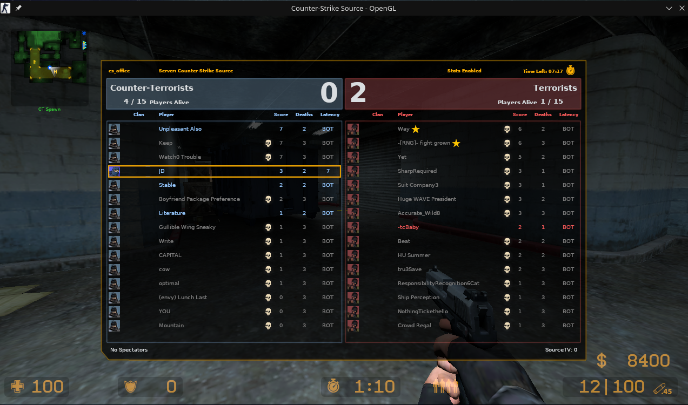

# Counter-Strike Source - Bot Profile Generator
*(w/ JSON config + CSV data values)*



## How To Add The `botprofile.db` To Counter-Strike Source
Find your `steamapps` folder, then go to common, Counter-Strike Source, then in the cstrike folder, then custom, then create another folder called `cstrike` and add the `botprofile.db` into that folder you created.

On linux, it is typically: `$HOME/.steam/steam/steamapps/common/Counter-Strike Source/cstrike/custom/cstrike/`

On windows, it should be (but may be different now, haven't used it in years): `C:\Program Files (x86)\Steam\steamapps\common\Counter-Strike Source\cstrike\custom\cstrike\`

## Compilation
This assumes that you have `Go` installed on your system as well as `make`.

If you need to install `Go`, check out [The Go Install Guide](https://go.dev/doc/install)

If you need to install `make`, you can use Homebrew or just use your package manager to install it. *(windows, idk)*

### Steps

```bash
cp example.AppConfig.json AppConfig.json
make clean
make build
make run
```


